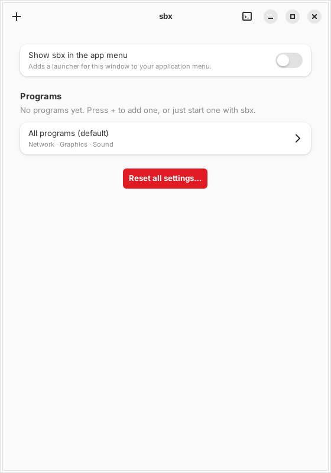

# sbx

Run a program in a [bubblewrap](https://github.com/containers/bubblewrap) sandbox. No profiles: the system is read-only, your real home is hidden, and the program gets a private home.

```
sbx firefox
sbx --net=none --here python3 script.py
```

`sbx-gui` is an optional GTK4/libadwaita editor for the settings files.



## Install

Needs Linux, Python 3.8+ and `bubblewrap` (0.8+ for `userns=0`).
Optional: GTK 4 + libadwaita 1.5 + PyGObject (GUI), `xdg-dbus-proxy` (`portals`), `pasta` (`net_private`), `systemd-run` (limits).

```
sudo apt install bubblewrap         # or your distro's equivalent
sudo install -m755 sbx sbx-gui sbx-selftest sbx-report /usr/local/bin/
sbx doctor                          # checks everything works
```

Man page and completions:

```
sudo install -Dm644 sbx.1 /usr/local/share/man/man1/sbx.1
sudo install -Dm644 tools/sbx-trace.1 /usr/local/share/man/man1/sbx-trace.1
sudo install -Dm644 completions/sbx.bash /usr/local/share/bash-completion/completions/sbx
sudo install -Dm644 completions/_sbx /usr/local/share/zsh/site-functions/_sbx
sudo install -Dm644 completions/sbx.fish /usr/local/share/fish/vendor_completions.d/sbx.fish
sbx desktop --install-menu          # sbx-gui in the app menu
sbx desktop --install-installer     # right-click a folder or archive: Open With Other Application, Install in sbx
```

Ubuntu 24.04+: AppArmor blocks user namespaces. `sbx doctor` shows the fix.

## What the program sees

- System: read-only
- Your home: hidden, replaced by `~/.sbx-homes/NAME`
- `/tmp`, `/run`: empty tmpfs
- Secrets (`/etc/shadow`, SSH host keys, other users): emptied
- Environment: cleared, except locale, terminal and desktop variables
- Network: shared unless `net=0` or `net_private=1`

It starts in its private home. Use full paths, or `--here` to share the current folder.

## Usage

```
sbx [options] PROGRAM [args]
sbx preview ...     print the command instead of running it
sbx show NAME       settings that apply, and where each came from
sbx list            programs you set up
sbx stop NAME
sbx clean NAME      delete a private home
sbx reset NAME      delete settings files, defaults apply again
sbx rebind NAME     accept a moved program as the same one
sbx export [NAME]   settings as one text file (-o FILE)
sbx import FILE     load an export back
sbx link NAME       typing NAME starts it through sbx
sbx open FILE       run a downloaded program ("Open with")
sbx install SRC     move a program (folder or archive) to ~/Apps/NAME, menu entry through sbx (--link: terminal command)
sbx uninstall NAME  remove a program made by sbx install
```

Options go before the program name.

### Installing a downloaded program

```
sbx install ~/Downloads/anki-26.9.4-linux-x86_64.tar.zst      # or the extracted folder; NAME is guessed (anki), or give one
                                                               # an app-menu entry starts it through sbx; add --link for a terminal command (typing: anki)
sbx uninstall anki
```

The program goes to `~/Apps/NAME` and is shared with it read-only. Its launcher loses the execute bit, so `./launcher` outside sbx fails with "Permission denied" and only sbx can start it (sbx sets the bit for its own run; this works for dynamically linked programs, and static ones keep the bit with a warning). Files the program saves go to its private home. The other files in the folder keep their execute bit, because the program starts them itself inside the sandbox. A folder you install is moved, not copied; an archive is unpacked and left where it is. Nothing in it is run.

| Option | Effect |
|---|---|
| `--net=none` | no network |
| `--net-private` | no localhost or local services (needs `pasta`) |
| `--private` | erase private home on exit |
| `--here` | share current folder, read-write |
| `--whitelist=PATH` / `--read-only=PATH` | share a path, read-write / read-only |
| `--name=NAME` | separate home and settings |
| `--memory=2G` `--tasks=512` `--cpu=200%` | limits |
| `--ignore-config` | ignore settings files |

Everything else: `sbx --help`, `man sbx` (includes downloaded and moved programs).

## Moved programs

A name is tied to the file that first ran under it. A moved file with the same content keeps its program. Other content under the same file name takes over once the original is gone. Files a program wrote next to its own file move with it. If sbx can't tell, the program waits for `sbx rebind NAME`. Details: `man sbx`.

## Settings

Plain `key=value`. `~/.config/sbx/default.conf` applies to all programs, `~/.config/sbx/apps/NAME.conf` to one.

```
net=0
portals=1
whitelist=~/Projects
memory=2G
```

A program that reads or creates files in the folder it starts in needs `folder=1` (a switch in `sbx-gui`: "Start in the program's own folder"). It starts in the folder its file sits in and shares that folder read-write. The program must sit in a folder of its own: your home, Downloads, Desktop, Documents and hidden folders are never shared, and sbx warns why. `--here` is the same for the folder you are in. Without a `folder` setting, a program that sits in a folder named after it (`G-Diffuser/`, `G-Diffuser-v1.2.3-linux-x64/`) gets this automatically, and sbx says so on start. `folder=0` turns that off.

Environment variables: `setenv=NAME=value` sets one for the program, `env=NAME` passes your own value through (also `--setenv=NAME=value`). `sbx-gui` has a list for both on each program's page.

`sbx show NAME` lists every setting. Flags beat files and can only make things stricter.

Back up or move settings with `sbx export -o FILE` and `sbx import FILE` (`--force` replaces settings that differ); `sbx-gui` has the same buttons.

## Trace

`sbx-trace` runs a program under [bpftrace](https://bpftrace.org) and reports which files it opened, looked for or changed, and which attempts failed (refused, read-only, or hidden by the sandbox). Use it to see what a setting would let through. It needs `bpftrace`, a kernel with BTF and root (it asks through `sudo` or `pkexec`).

```
sbx-trace -- sbx firefox       # run it and print the report
sbx-trace --last               # show the last report again
sbx-trace --suggest            # read_only= / whitelist= lines for what was refused (read them first)
sbx-trace --diff               # compare with the run before: did a setting help?
sbx-trace --html -o report.html   # one page to open or send: a map of the folders, and what needs attention
```

`sbx-trace-gui` is a window for the same: while the program runs it shows the files touched so far, refreshed every second, and its save button writes the report as the web page. Install: `sudo install -m755 tools/sbx-trace tools/sbx-trace-gui /usr/local/bin/`. Reports are kept in `~/.local/state/sbx-trace`.

## Test

```
python3 test_sbx.py              # all tests (isolation tests need bubblewrap)
python3 tools/test_sbx_trace.py  # sbx-trace and its window (no root or bpftrace needed)
python3 tools/test_sbx_trace_gui.py
sbx ./sbx-selftest               # inside the sandbox: every row should say PASS
sbx ./sbx-report                 # what the program can reach
```

Failed runs are logged to `~/.local/state/sbx/sbx.log`.

## Develop

`sbx` and `sbx-gui` are generated. Edit `src/` and `src/gui/`, run `python3 build.py`, commit the result. `python3 build.py --check` runs in CI.

## Limits

- Convenience sandbox, not a security boundary against hostile programs. The syscall filter is a blocklist.
- Wayland without security-context support gives the program the full socket (a warning is shown). `wayland_strict` is on by default where the compositor supports security contexts, so a failed attempt there gives no Wayland instead of the full socket; where it can't, it is off and sbx-gui greys the switch out. Set it yourself to override.
- `net_private=1` is not a firewall: your local network stays reachable.
- Read-write shares (`--here`, `whitelist=`) let the program plant files that later run outside the sandbox. Share only what it needs.
- 32-bit programs (Wine, Steam) fail. Terminal programs have no `/dev/tty`, so password prompts don't work.
- One private home per name: use `--name` for separate ones.

## License

GPL-3.0-or-later. See [LICENSE](LICENSE).
