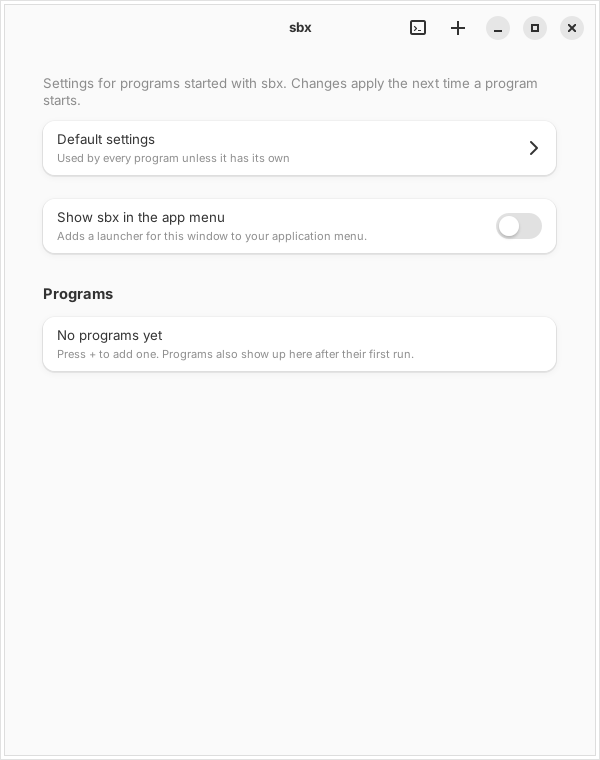

# sbx

Run a normal program in a [bubblewrap](https://github.com/containers/bubblewrap) sandbox, firejail style. No profiles to write: the system is visible but read-only, your real home is hidden, and the program gets a private home of its own.

```
sbx firefox
sbx --net=none --here python3 script.py
```

`sbx-gui` is an optional GTK4/libadwaita editor for the same settings files. A program's page has Run and Stop at the top, a one-line summary of what the program can do, and a search box. Network is one choice (full, internet only, none), and switches that do nothing until another one is on are greyed out.



## Install

Requires Linux, Python 3.8+ and `bubblewrap` (0.8+ for `userns=0`). For the GUI: GTK 4, libadwaita 1.5+ and PyGObject. For `portals`: `xdg-dbus-proxy`. For `net_private`: `pasta` (package `passt`). For memory/task/CPU limits: `systemd-run` (systemd).

```
sudo apt install bubblewrap         # or dnf, pacman, ... your distro's equivalent
sudo install -m755 sbx sbx-gui sbx-selftest sbx-report /usr/local/bin/
sbx doctor                          # checks that everything works on this machine
```

Optional extras, each one line:

```
sudo install -Dm644 sbx.1 /usr/local/share/man/man1/sbx.1                                       # man sbx
sudo install -Dm644 completions/sbx.bash /usr/local/share/bash-completion/completions/sbx       # bash completion
sudo install -Dm644 completions/_sbx /usr/local/share/zsh/site-functions/_sbx                   # zsh completion
sudo install -Dm644 completions/sbx.fish /usr/local/share/fish/vendor_completions.d/sbx.fish   # fish completion
sbx desktop --install-menu          # sbx-gui in your app menu; --remove-menu undoes it
```

Open a new shell for the completion to load. If your zsh doesn't find `_sbx`, put it in a folder on your `$fpath` and run `compinit`; the comment at the top of each completion file says how, also for a per-user install.

The app menu entry needs `sbx-gui` installed in `/usr/local/bin` as above: only a root-owned copy is used, so a program running as you can't replace what the menu starts. The "Show sbx in the app menu" switch in the window does the same as the command.

`sbx doctor` also explains the usual surprise on Ubuntu 24.04+, where AppArmor blocks the user namespaces bubblewrap needs.

## What the program sees

| | |
|---|---|
| System (`/usr`, `/etc`, ...) | read-only |
| Your home | hidden. Replaced by `~/.sbx-homes/NAME`, where NAME is the program's name (or `--name`) |
| Other users, `/root`, `/mnt`, `/media`, `/srv`, `/var/tmp`, `/var/log`, mail spools | empty |
| `/tmp`, `/run` | fresh empty tmpfs |
| `/etc/shadow`, `sudoers`, SSH host keys, `/etc/ssl/private`, saved NetworkManager connections | emptied |
| `/etc/machine-id`, boot id | random per program (`~/.config/sbx/ids/NAME`) / random per run |
| Hardware identity | `/sys/devices/virtual/dmi/id` emptied; with `net=0` or `net_private=1` also `/sys/class/net` (MAC addresses) |
| Environment | cleared; only locale, terminal and desktop variables are kept, plus what you pass with `env=` / `setenv=` |
| Namespaces | all unshared (PID, IPC, UTS, user, cgroup); network shared unless `net=0` (or its own, through `pasta`, with `net_private=1`); nested user namespaces blocked with `userns=0` |
| System calls | a blocklist: `kexec_*`, `perf_event_open`, `bpf`, `syslog`, `keyctl` and friends, `mbind` and NUMA calls, `open_by_handle_at`, `io_uring_*`, `userfaultfd`, `process_vm_readv/writev`, `kcmp`, `pidfd_getfd`, the new mount API (`open_tree`, `move_mount`, `fsopen`, `fsconfig`, `fsmount`, `fspick`, `mount_setattr`), and all 32-bit/x32 calls |
| Desktop look (`theme=1`) | your fonts, icons and GTK/fontconfig settings, read-only. Your title-bar button layout (so GNOME's minimize and maximize buttons show up) and cursor theme and size live in dconf, which the sandbox can't read, so sbx reads them on your side and hands over only those settings as a small GSettings key file (the program gets `GSETTINGS_BACKEND=keyfile`). Every value is checked first, and nothing else from dconf is shared. `--no-theme` turns all of this off |
| Wayland | through a [security context](https://wayland.app/protocols/security-context-v1) when the compositor supports it (no screen capture or input injection), otherwise the full socket with a warning |

The program starts in its private home. Use full paths, or `--here` to share the current folder. If an argument names something that exists on your side but isn't visible inside, sbx says so.

## Usage

```
sbx [options] PROGRAM [args]
sbx preview [options] PROGRAM [args]     print the command instead of running it
sbx show [options] NAME                  the settings that apply, and which file or flag each came from
sbx doctor                               check bubblewrap, helpers, Wayland support, settings files
sbx list [--all]                         the programs you set up, where each comes from, and which are running; --all adds the ones only run from the terminal
sbx rebind NAME | --dismiss NAME         decide a program that moved, or whose name another file wants: accept it as the same program, or drop the question
sbx stop NAME                            stop a running program
sbx clean [--yes] NAME | --unused        delete a private home and its machine-id (refused while the program runs); --unused: every nearly empty home of a program nobody set up
sbx link NAME [--desktop]                typing NAME in a terminal starts it through sbx (a link in ~/.local/bin, like firecfg); --desktop covers its app-menu launchers too
sbx link --remove NAME [--desktop]       undo that
sbx reset [--yes] NAME|--default|--all      delete settings files so the built-in defaults apply again (data stays)
sbx open FILE                            run a downloaded program with sensible defaults (what "Open with" calls)
sbx desktop NAME                         make a launcher (.desktop file) start the program through sbx; NAME is its id or the program it starts
sbx desktop --remove NAME                undo that
sbx desktop --install-opener             add "Run in sbx" to your file manager's Open With (--remove-opener undoes it)
sbx desktop --install-menu               add sbx-gui to your app menu (--remove-menu undoes it; needs sbx-gui installed in /usr/local/bin)
```

Options go before the program name. A program named like a command: `sbx -- clean`. `man sbx` has the full text.

| Option | Effect |
|---|---|
| `--net=none` | no network |
| `--net-private` | with the network on: internet, but not this computer's own services (see below). Needs `pasta`. Setting: `net_private=1` |
| `--private` | private home is erased on exit |
| `--here` | share the current folder, read-write (not your whole home, not hidden folders) |
| `--whitelist=PATH` | share a file or folder, read-write; repeatable |
| `--read-only=PATH` | share a file or folder, read-only; repeatable |
| `--allow-sensitive` | allow sharing `~/.ssh`, `~/.gnupg`, `~/.aws`, browser profiles and other secret folders (refused otherwise) |
| `--no-wayland` | hide the Wayland socket |
| `--wayland-strict` | no Wayland at all if the compositor can't restrict it |
| `--x11` | share the X11 socket (weaker isolation) |
| `--no-gpu` | hide `/dev/dri` and NVIDIA devices |
| `--gpu-render-only` | of `/dev/dri` share only the render nodes (`renderD*`) that programs draw with, not the `card*` nodes that can also drive the display. NVIDIA devices are not affected. Setting: `gpu_render_only=1` |
| `--no-sound` | hide PipeWire/PulseAudio (this includes the microphone) |
| `--camera` `--alsa` `--input` `--kvm` `--rocm` `--printing` | share `/dev/video*` (and the Camera portal), `/dev/snd`, `/dev/input` (plus `/run/udev`, so controllers are recognised), `/dev/kvm`, `/dev/kfd`, the CUPS socket |
| `--tray` | let the program show a tray icon and answer media keys, through `xdg-dbus-proxy`. Works without `--portals`; only the tray and media-key names are allowed on the bus |
| `--ssh-agent` | share your SSH agent socket; the program can sign as you while it runs |
| `--no-theme` | don't show your fonts, icons and GTK/fontconfig settings, and don't pass on your title-bar button layout and cursor theme (see below) |
| `--compat` | pass through the graphics and toolkit variables that are set (`WGPU_*`, `ICED_BACKEND`, `MESA_*`, `RADV_*`, `VK_ICD_FILENAMES`, `SDL_VIDEODRIVER`, `QT_QPA_PLATFORM`, `GDK_BACKEND`...). Tokens, keys and everything else stay out |
| `--portals` | allow notifications and basic desktop portals via `xdg-dbus-proxy` |
| `--portal-screenshot` `--portal-screencast` `--portal-location` `--portal-shortcuts` `--portal-wallpaper` `--portal-launcher` `--portal-remote-desktop` `--portal-input-capture` `--portal-secret` | one more desktop portal each (needs `--portals`). Settings: `portal_screenshot=1` and so on |
| `--hostname` | program sees hostname `sbx`, also in `/etc/hostname` and `/etc/hosts` |
| `--privacy` | program sees a minimal `/etc/passwd` (you, root, nobody): your full name and the other accounts stay out |
| `--no-userns` | the program can't create user namespaces |
| `--env=NAME` / `--setenv=NAME=VALUE` | pass a variable through / set one (`HOME`, `USER`, `LOGNAME`, `XDG_RUNTIME_DIR`, `SBX_ACTIVE` are protected) |
| `--allow-syscall=NAME` | turn one of the extra blocked calls back on: `io_uring`, `userfaultfd`, `process_vm_readv`, `process_vm_writev`, `kcmp`, `pidfd_getfd`, `open_tree`, `move_mount`, `fsopen`, `fsconfig`, `fsmount`, `fspick`, `mount_setattr` |
| `--memory=2G` `--tasks=512` `--cpu=200%` | resource limits through `systemd-run --user` |
| `--name=NAME` | use another private home, machine-id and settings name than the program's |
| `--ignore-config` | ignore the settings files for this run |
| `--rebind` | accept that this file is the same program as the one that first used its name, without asking (see [Moving a program](#moving-a-program)) |

Shared paths must be inside your home (not the home itself), on `/mnt`, `/media` or `/run/media`, or in `/tmp`. `~/.config/sbx` and `~/.sbx-homes` can never be shared. A folder is mounted before what is inside it, so `whitelist=~/a/b` stays writable even with `read_only=~/a`. Shared folders that don't exist yet in the private home are created as empty mountpoints for the run and removed again afterwards if nothing was written to them.

## Typing the name always uses sbx

`sbx link firefox` puts a link called `firefox` in `~/.local/bin`. Typing `firefox` then starts the real Firefox through sbx, with the settings for `firefox`, and arguments such as `firefox --private-window` go to the program, not to sbx. This is what firejail's `firecfg` does. `sbx link --remove firefox` undoes it, and `sbx-gui` has the same thing as a switch on the program's page.

It only works while `~/.local/bin` comes before the program's own folder in your `PATH` (sbx warns when it doesn't; most distros put it first). Starting the program by its full path (`/usr/bin/firefox`) skips sbx, and so does anything that doesn't use your `PATH`. A launcher needs `sbx desktop` as well: `sbx link NAME` says when it finds one that starts NAME, and `sbx link NAME --desktop` does both (`--remove NAME --desktop` undoes both). Launchers are found by the program their `Exec=` line starts, so `sbx link google-chrome-stable --desktop` finds `google-chrome.desktop`. `sbx desktop` never replaces a launcher in `~/.local/share/applications` that sbx didn't make. Inside a sandbox a linked program starts directly.

## Downloaded programs

For a program you downloaded and don't want to set up by hand:

```
sbx desktop --install-opener     # once
```

Now right-click a program file (a game or any other binary) and choose **Open With → Run in sbx**; it is also the default for program files that don't have the execute bit, which is how browsers save downloads. Shell scripts (`.sh`, such as self-extracting installers) get it under Open With too, but double-clicking one still opens your editor or runs it directly. No terminal needed. `sbx open FILE` does the same from a shell.

A program with no settings file of its own (`~/.config/sbx/apps/NAME.conf`) starts with these defaults:

- **Its own folder, read-write**, and it starts there. Games find their data beside the binary and can save next to it. Nothing else of your home is visible. Generic folders (your home, `Downloads`, `Desktop`, `Documents` and the other user folders, including translated names) and hidden folders are never shared this way; a file loose in `~/Downloads` gets only itself, so put a game in its own folder first.
- **Game controllers** (`/dev/input`), plus the usual defaults: network, GPU, sound and Wayland on.
- It runs even without the execute bit, if it is a dynamically linked ELF program (the usual case; static binaries such as many Go programs need `chmod +x`). The bit is set only while the program runs and then put back, so programs that read their own file (.NET single-file apps) work; if the file can't be changed, sbx starts it through the system loader instead. Plain `sbx ./FILE` does the same.
- If it fails right away you get a desktop notification with the reason (a program that exits with an error within 15 seconds counts as failed).

If a settings file exists for that name, it is used exactly as written and none of the defaults above apply. Tighten a program by creating the file, for example `net=0`, or use `sbx-gui`.

Two limits. A file that *has* the execute bit still starts directly when you double-click it; sbx can't intercept that, so use Open With or `chmod -x`. And these defaults trade isolation for convenience (the network is on, and the program's folder is writable); for something you don't trust at all, use `sbx --net=none --private FILE`.

## Moving a program

A program name owns its settings and its private home, so sbx remembers which file first ran under it (`~/.config/sbx/origins/NAME`: the path, then the size, modification time and SHA-256 of the file) and checks it when the same name runs from another path. You don't have to do anything when you move a game out of `~/Downloads`. When the path differs, the first of these that matches decides:

| | the file at the new path | the old path | what happens |
|---|---|---|---|
| a | same content (same SHA-256) | any | the same program, moved or copied: accepted without a question, the record follows it |
| b | other content, same file name | gone | moved, then updated: accepted, with one line: `'game' moved from ~/Downloads/Crash to ~/Games/Crash` |
| c | other content, other file name | gone | unclear: on a terminal sbx asks `[y/N]`; without one the decision is left pending |
| d | other content | still there | two different programs want one name: refused, left pending; start the other with `--name=OTHER` |

Moves between system folders (`/usr`, `/opt`, `/snap`, ...) are always fine. A run from the recorded path is never held up by what the file contains: when its size or modification time changed (an update, a game that patches itself) sbx only reads it again and updates the record. The file is read in full when a name is first recorded and whenever it changes, which takes a moment for a multi-gigabyte game.

**A renamed file is still its program.** The rules above start from a name, and the name comes from the file name, so renaming `game-linux` to `game` would look like a new program. When you start a file by its path (Open With, `sbx ./game`, not `--name`, not a name from your `PATH`), sbx therefore looks at the content first, before the new file name counts: if the file has the size and SHA-256 of exactly one recorded program whose file is gone, it runs as that program, with its settings, private home and saves, and says so in one line. Only a file of a size such a program had is read. Leftovers of an earlier run under the new name do not stop this: sbx drops the second origin record of the same file and leaves that private home alone (the line names it, `sbx clean NEW` deletes it). `sbx show ./FILE` tells which program a file is. A private home of the new name counts as that leftover however big it is (a game that ran once has written logs and caches into it). The new name stays only when it has settings of its own (`apps/NEW.conf`); the line then says so and `--name=OLD` runs the file as the old program. A copy (the original is still there), a file of another size or content, and a file that matches several gone programs where none stands out stay as they are: the new file name, a program of its own. When several gone programs match (earlier runs under wrong names leave a record each), the one somebody set up wins: the only one with a settings file, else the only one whose private home holds data. The other records of that content whose file is gone and that have no settings are dropped; their private homes stay, and the line names them.

**What the program stored beside its file moves with it.** A program that writes next to its own file (settings, saves, a chosen disc image) finds that in its private home under the folder the file is in: `~/Downloads/settings.json` is `~/.sbx-homes/NAME/Downloads/settings.json`. After a move the folder is another one, and the program would look in an empty place. So when sbx accepts a move (rules a to c, `sbx rebind`, `--rebind`) and the old file is gone, it moves what is stored under the old folder to the new folder, inside the private home only, and says so in one line. It never overwrites something that is already there, never follows a link, does nothing for a copy (the original may still be in use) or for a file outside your home, and does not touch the real folders. It happens once, when the move is accepted: a program that was moved before this existed keeps its files under the old folder in `~/.sbx-homes/NAME/`, and you can move them by hand.

**Pending** means sbx did not start the program. It wrote `~/.config/sbx/pending/NAME` (old path, new path, which rule), sent a desktop notification (with an "Open sbx" button where `notify-send` supports actions, plain text otherwise) and exited with an error. Decide with `sbx rebind NAME` (it is the same program: the record moves to the new file) or `sbx rebind --dismiss NAME` (drop the question; sbx asks again the next time the program starts from there). `sbx-gui` shows the same thing: a banner on the main page ("N programs are waiting for your decision") and, on the program's page, the old and new path with **Same program, accept** and **Dismiss**. For rule d the original is still there, so the warning is stronger and accepting is asked twice. A pending decision disappears by itself when the situation does, for example when the file is back at its recorded path. `--rebind` stays as the override: accept this file now, without asking.

The **Run** button in `sbx-gui` starts a program that is in your `PATH` by its name, and any other (a downloaded game) from the file sbx recorded for it, like Open With does. If that file is gone, it says so: start the program once from its new place (Open With, Run in sbx) and sbx recognises the move.

The program list shows where each program comes from (`System: /usr/bin`, `Downloaded: ~/Downloads/Crash`, `Home: ...`, `link` and `menu` for the other ways it starts through sbx, `Missing: ...` when the recorded file is gone, `moved from ...` after a move), in `sbx-gui`, `sbx list` and `sbx show`.

## Settings

Plain `key=value` files, `#` starts a comment:

- `~/.config/sbx/default.conf` applies to every program
- `~/.config/sbx/apps/NAME.conf` applies to one program and overrides the default

```
net=0
gpu=0
portals=1
whitelist=~/Projects
read_only=~/.gitconfig
env=HTTPS_PROXY
setenv=GTK_THEME=Adwaita:dark
memory=2G
```

Switches (all `0`/`1`), with defaults: `net=1`, `net_private=0`, `wayland=1`, `wayland_strict=0`, `x11=0`, `gpu=1`, `gpu_render_only=0`, `sound=1`, `portals=0`, `private=0`, `hostname=0`, `privacy=0`, `userns=1`, `theme=1`, `camera=0`, `alsa=0`, `input=0`, `kvm=0`, `rocm=0`, `printing=0`, `ssh_agent=0`, `allow_sensitive=0`, `compat=0`, `tray=0`, and the extra portals `portal_screenshot`, `portal_screencast`, `portal_location`, `portal_shortcuts`, `portal_wallpaper`, `portal_launcher`, `portal_remote_desktop`, `portal_input_capture`, `portal_secret` (all `0`, and only used when `portals=1`). Anything else (`net=maybe`) is reported with its file and line number and ignored, instead of silently counting as on or off.

Lists that add up across the two files: `whitelist`, `read_only`, `env`, `setenv`, `allow_syscall`. Limits: `memory`, `tasks`, `cpu`; an empty value in a program's file cancels the default's. Command-line flags beat the files. Flags can only change a setting in the direction shown in the table above (for example, there is no flag to turn the network back on); `--ignore-config` starts from the built-in defaults.

`sbx show NAME` prints the result of all this. `sbx-gui` edits the same files: run `sbx-gui`, `sbx-gui NAME` or `sbx-gui --default`. It asks `sbx schema` which switches exist, so a switch added to sbx appears there at once.

### Whether to turn `userns` off

`userns=0` closes the biggest gap in the syscall filter (nested user namespaces are a common route into kernel bugs), but programs that build their own sandbox need it: Chromium, Electron apps, Flatpak, nested bubblewrap. That is why it defaults to on. Try `--no-userns` on programs that don't sandbox themselves.

## Checking it

```
python3 test_sbx.py              # all tests, as a normal user
sbx ./sbx-selftest               # run inside the sandbox: every row should say PASS
sbx --net=none --no-userns ./sbx-selftest --expect=net0,userns0   # also check what you asked for
sbx ./sbx-report                 # a readable overview of what the program can reach
```

`sbx-report` is for looking at a setup rather than testing it: network, sockets, devices, shared folders, desktop portals, the tray and the system-call filter, each as ALLOWED, blocked, hidden or EXPOSED (reachable, and probably not meant to be). It can't see your settings from inside, so tell it what you turned on: `sbx --portals --portal-location ./sbx-report --portals=location`, or `--tray`. It also saves the text as `sbx-report.txt` in the program's private home.

`test_sbx.py` has three parts. The **snapshot** (`sbx-preview.snap`) holds the exact `bwrap` command for a number of option sets; when a change to `sbx` alters the mount list the test fails with a diff. Review it, then `UPDATE_SNAPSHOTS=1 python3 test_sbx.py` and commit the new snapshot. The **unit tests** cover settings parsing and precedence, path rules, mount ordering, the syscall filter (run through a small BPF interpreter, with numbers checked against the kernel headers when present), the Wayland client (against a fake compositor) and launcher rewriting. The **isolation tests** run real sandboxes against canary files planted in a temporary home: they check every flag, the exit status, cleanup of mountpoints, `clean`, `desktop` and more, and need bubblewrap. A negative control checks that the self-test fails without the sandbox.

`sbx-selftest` tries to read `~/.ssh`, the real `~/.config/sbx` and `~/.sbx-homes`, `/etc/shadow` and `/root`, writes to the system, and calls blocked system calls; each must fail. Pass extra paths to check that they are hidden too.

**When a program won't start.** Every run is logged to `~/.local/state/sbx/sbx.log` (owner-only, trimmed when it passes 1 MB): the start with the switches that were on, warnings and errors, and the exit code. When sbx has no terminal (started from the app menu, a file manager or `sbx-gui`), what the program prints to stderr goes into the log as well, without control characters and at most 2 MB per run. A program that exits with an error within 10 seconds also raises a notification (needs `notify-send`); where the notification supports buttons, clicking it opens `sbx-gui --log NAME`. In `sbx-gui` the terminal button in the header, or **Show log** on a program's page, opens the same page: the checks of `sbx doctor` and the recent log. When a program's last run ended with an error that matches a known pattern (no usable sandbox, no graphics device, no display, no network, no camera), the page also suggests the one setting that usually fixes it, with a button; nothing changes until you press it.

## Development

`sbx` and `sbx-gui` are generated: edit the fragments in `src/` and `src/gui/` (one layer per file, joined in number order), then run `python3 build.py` and commit the result. `python3 build.py --check` fails if either file is out of date or a fragment uses a name from a higher layer; CI runs it.

## Limits

- This is a convenience sandbox, not a security boundary against a hostile program or a kernel exploit. The system-call filter is a blocklist, and nested user namespaces are allowed unless you set `userns=0`.
- **Wayland:** the security context is implemented against the protocol and tested against a fake compositor; it has not been tried here on a real Mutter, KWin or wlroots session. Check with `sbx doctor`. Without compositor support the program gets the full socket (a warning says so), which on some compositors includes screen capture and input injection; `wayland_strict=1` turns Wayland off in that case instead.
- With `net=1`, the abstract Unix socket namespace is shared with the host, so `x11=0` does not fully keep a program off an X server that listens on an abstract socket, and `/sys/class/net` still lists your network cards. `net=0` closes both; so does `net_private=1`, which gives the program a network namespace of its own.
- `net_private=1` runs the program behind [`pasta`](https://passt.top/) in a network namespace of its own: nothing is forwarded in either direction, the gateway is not mapped to this computer (`--no-map-gw`), and name lookups go to a forwarder address that `pasta` answers. The internet works; `localhost`, services listening on this computer and its own addresses don't. **Your local network stays reachable**, so this is not a firewall. It does nothing with `net=0` (a warning says so), and sbx refuses to start without `pasta` instead of falling back to the shared network. Because the namespace is made by `pasta`, the program sees `/etc/resolv.conf` replaced by a generated one, and the filter is passed through a file in `$XDG_RUNTIME_DIR/sbx` (`pasta` closes inherited descriptors); `sbx preview` shows the exact command.
- `sound=1` gives access to the PipeWire/PulseAudio socket, which includes microphone and, depending on setup, camera and screen-capture nodes.
- `portals=1` lets the program ask your desktop to open URLs and files and show file choosers. Leave it off for programs you don't trust. **The file chooser is untested:** the portal sees the program as an ordinary host application, so it hands back real host paths that may not exist inside the private home. Choosing a file in a shared folder works the same as typing its path; elsewhere it probably won't.
- Sharing `~/.ssh`, `~/.gnupg`, `~/.aws` and similar needs `--allow-sensitive`. The list covers common cases, not every program that keeps secrets.
- Not for NixOS or Guix in general: the usual `/run/current-system` links are recreated, but nothing here has been tried on them.
- The MAC-address, DMI and `/var/log` hiding is a privacy measure against fingerprinting by honest programs, not a guarantee; other files under `/sys` and `/proc` still describe the machine.
- 32-bit programs (Wine, Steam, old games) fail because 32-bit system calls are blocked.
- `--new-session` is on, so terminal programs have no `/dev/tty` and no job control. Prompts that read from the terminal directly (`ssh`, `sudo`, `git` passwords) won't work.
- Sharing a single file read-write can break programs that save by renaming over it. Share the folder instead.
- A read-write share (`--here`, `whitelist=`) lets the program plant files that later run outside the sandbox: git hooks, Makefiles, `.envrc`, scripts. Share only what it needs, and prefer `read_only=` where you can.
- Each program name has one private home, so `sbx python3 a.py` and `sbx python3 b.py` share it; use `--name` to separate them.
- A program name is tied to the file that first ran under it, and moves are recognised by content and file name (see [Moving a program](#moving-a-program)); a different program under the same name is held for your decision, so a download called `firefox` can't quietly pick up firefox's settings and private home. Moves between system folders are fine. **Rule b trades some of that for convenience:** once the original is deleted, a file with the same file name can take over the name (with one line printed), so a malicious download called like a program you removed inherits its settings and private home; the sandbox still applies to it, but with those settings. For a different program use `--name=OTHER`. The first run after upgrading records whatever is there now.
- `sbx link` is a convenience, not enforcement: a full path, a launcher that doesn't use your `PATH`, or a different `PATH` skips it.
- Programs on another drive (`/mnt`, `/media`, `/run/media`) can't be started; copy them elsewhere first.
- Not for root; `sbx` refuses to run as root or inside another `sbx` sandbox.

## License

GPL-3.0-or-later. See [LICENSE](LICENSE).
